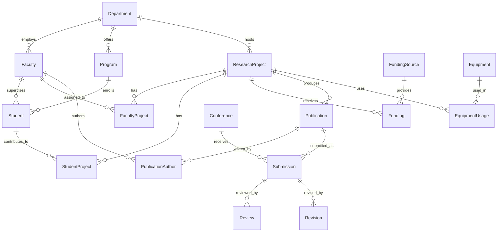

# Research Management System (RMS)

A relational database for managing the full lifecycle of academic research — departments, faculty, students, projects, funding, publications, conferences, reviews, revisions, equipment usage, and an append-only audit trail.

MySQL 8.0.16+ · MIT licensed · SQL-only (no application layer yet)

## What's in this repository

| File | Purpose | Run it |
|---|---|---|
| `Task 1.sql` | **DDL only** — drops and recreates all 18 tables plus 4 integrity triggers. Safe to re-run. | 1st |
| `Task 3.sql` | **Sample data** — truncates every table, then loads departments, faculty, students, projects, funding, publications, conferences, reviews, and equipment. | 2nd |
| `Task 4.sql` | **21 analytical queries** — students, supervision, funding, publications, conferences, equipment, mentors, rankings. | 3rd |
| `Task 5.sql` | **7 reporting views** plus example SELECTs that query them. | 4th |
| `RMS.sql` | **All-in-one build**: schema + sample data + stored functions/procedures + 31 triggers + 8 views + demonstration DML. | Alternative to Tasks 1–5 |

> **Pick one path.** Either run `Task 1 → Task 3 → Task 4 → Task 5`, or run `RMS.sql` on its own. Running both will double-load the sample data.

## Quick start

```bash
# 1. Create a database
mysql -u root -p -e "CREATE DATABASE rms CHARACTER SET utf8mb4 COLLATE utf8mb4_unicode_ci;"

# 2a. Modular path (recommended for study)
mysql -u root -p rms < "Task 1.sql"
mysql -u root -p rms < "Task 3.sql"
mysql -u root -p rms < "Task 4.sql"
mysql -u root -p rms < "Task 5.sql"

# 2b. Or the all-in-one path
mysql -u root -p rms < RMS.sql
```

Requires MySQL **8.0.16 or newer** — the scripts use `CHECK` constraints, `DEFAULT (CURRENT_DATE)`, `CREATE OR REPLACE VIEW`, and `ALTER TABLE ... DROP CONSTRAINT`.

## Schema at a glance

18 tables across five domains:



| Domain | Tables |
|---|---|
| Organisation | `Department`, `Program`, `Faculty`, `Student` |
| Projects | `ResearchProject`, `FacultyProject`, `StudentProject` |
| Funding | `FundingSource`, `Funding` |
| Publications | `Publication`, `PublicationAuthor`, `Conference`, `Submission`, `Review`, `Revision` |
| Resources & audit | `Equipment`, `EquipmentUsage`, `AuditLog` |

See [docs/SCHEMA.md](docs/SCHEMA.md) for every column, constraint, and relationship.

## Business rules enforced in the database

The schema does not rely on application code for integrity:

- **Self-mentoring is blocked** — `trg_faculty_no_self_mentor_insert/update` (and the recursive `mentor_id` FK).
- **Reviewers must be present** — `trg_review_reviewer_present_insert/update` requires either `reviewer_faculty_id` or `reviewer_name`.
- **Student contribution is 0–100%** — `trg_studentproject_contrib_limit_insert/update`.
- **Supervisors must exist in Faculty** — `trg_student_valid_supervisor_insert/update`.
- **Funding cannot be negative or dated in the future** — `trg_funding_no_negative_insert/update`.
- **Faculty cannot be deleted while supervising** — `trg_faculty_prevent_delete_if_supervising`.
- **AuditLog is append-only** — `trg_auditlog_no_update` and `trg_auditlog_no_delete` raise `SQLSTATE '45000'`.
- `RMS.sql` additionally records the acting user through `fn_current_app_user()` and the session variable `@app_user`.

```sql
SET @app_user = 'faculty:ahmed.alfarsi';
UPDATE ResearchProject SET status = 'Completed' WHERE project_id = 2;
SELECT * FROM vw_AuditTrail ORDER BY change_time DESC LIMIT 5;
```

## Stored programs (in `RMS.sql`)

**Functions**
- `fn_CalculateTotalProjectFunding(project_id)` — total funding for a project
- `fn_CountFacultyPublications(faculty_id)` — publication count for a faculty member
- `fn_TotalStudentContribution(student_id)` — summed contribution percentage
- `fn_current_app_user()` — current `@app_user`, falling back to `CURRENT_USER()`

**Procedures** — see `RMS.sql` for signatures and example calls.

## Reporting views (in `Task 5.sql`, 8 in `RMS.sql`)

| View | Purpose |
|---|---|
| `vw_StudentResearchProfile` | Student, program, supervisor, project count and contribution |
| `vw_FacultyResearchProfile` | Faculty, supervised students, projects, publications |
| `vw_ProjectFundingSummary` | Funding totals per project and source |
| `vw_PublicationAuthorSummary` | Authors per publication, corresponding author |
| `vw_ConferenceSubmissionStatus` | Submissions grouped by decision |
| `vw_StudentOwnProfile` / `vw_FacultyOwnProfile` | Single-person profile views |
| `vw_AuditTrail` | Human-readable audit log (`RMS.sql`) |

## Query index (`Task 4.sql`)

1. Students by program and department
2. Students and their supervisors (including unassigned)
3. Faculty supervising more than 5 students
4. Projects with more than 3 students
5. Projects funded above 500,000
6. Students on more than one project
7. Faculty with at least one publication
8. Publications with more than 3 authors
9. Corresponding-author publications for a faculty member
10. Conferences with more than 5 submissions
11. Accepted submissions
12. Students with no project participation
13. Faculty supervising no students
14. Projects using a specific piece of equipment
15. Mentors and their mentees
16. Faculty with no mentor
17–18. Highest-funded project (two equivalent methods)
19. Faculty authors with the most publications
20. Department(s) with the most research projects
21. Projects ranked by average student contribution

## Troubleshooting

| Error | Cause / fix |
|---|---|
| `ERROR 3823` on trigger creation | MySQL 8.0.16 rejects subqueries in CHECK constraints — this repo uses triggers instead. Use 8.0.16+. |
| `ERROR 1418` creating a function | Binary logging requires `DETERMINISTIC`, `NO SQL`, or `READS SQL DATA` — all functions here declare it. |
| `Table already exists` | You ran both `RMS.sql` and `Task 1.sql`. Re-run `Task 1.sql` first (it drops all tables). |
| `Duplicate entry` on sample data | Sample data was loaded twice. Re-run `Task 3.sql` (it truncates every table). |
| `Cannot delete faculty...` | Intended: reassign their students/projects first, or delete dependents. |

## Contributing

Issues and pull requests are welcome. Please keep DDL changes in both `Task 1.sql` and the matching section of `RMS.sql`, and add a short comment explaining any new constraint or trigger.

## License

[MIT](LICENSE)
